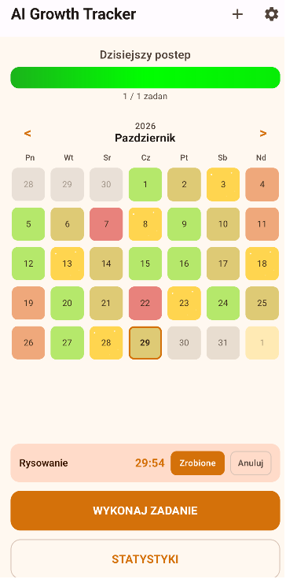
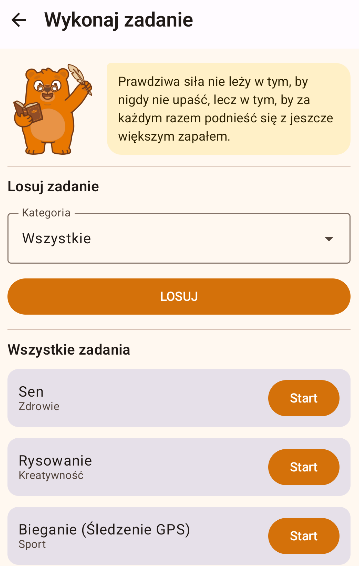
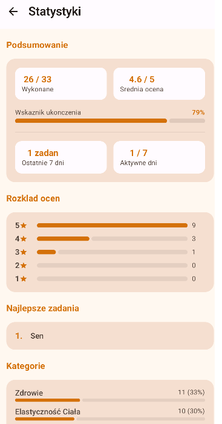
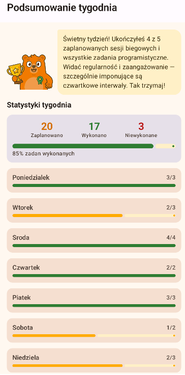
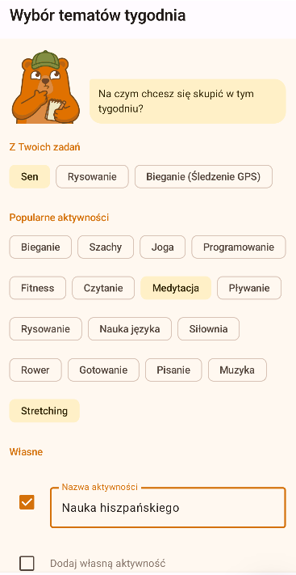
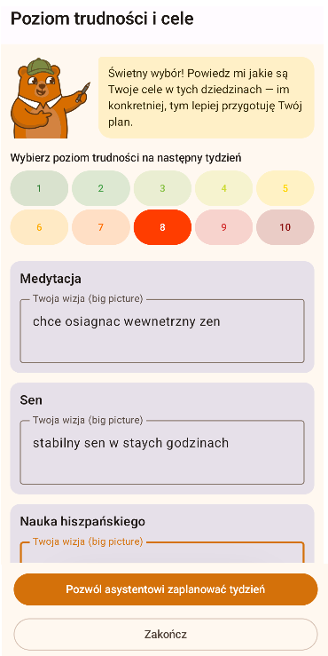

# AI Growth Tracker

Androidowa apka do ogarniania własnego rozwoju - planujesz zadania, odhaczasz je, a na koniec tygodnia dostajesz od AI (Gemini) rozpiskę na kolejny. Zaczęło się od prostego trackera zadań, a skończyło na czymś, co ma kalendarz, statystyki, logowanie, powiadomienia i nawet tracking biegów z mapą. Projekt robiłem solo, w połowie na własny użytek, w połowie na zaliczenie projektu na Politechnice Poznańskiej

<p align="center">
  
</p>

## O co chodzi

Pomysł był banalny: chciałem coś, co nie tylko trzyma listę "to-do", ale faktycznie pomaga trzymać się planu.

## Funkcje

- **Kalendarz z progresem** - widok miesiąca, każdy dzień koloruje się zależnie od tego, ile ogarnąłeś
- **Zadania z timerem** - tworzysz zadanie z kategorią i priorytetem, odpalasz minutnik i robisz swoje
- **Plan tygodniowy od AI** - w niedzielę asystent (Gemini) generuje plan na kolejny tydzień, uwzględniając przy tym święta i weekendy
- **Statystyki** - wykresy postępów + podsumowania dzienne i tygodniowe
- **Tracking biegów** - GPS, trasa na mapie (Mapbox), historia treningów - w planach podpięcie API strava
- **Powiadomienia** - przypomnienia o zaplanowanych zadaniach
- **Firebase** - logowanie i synchronizacja danych między urządzeniami
- **Health Connect** - podpięcie pod krokomierz

## Czym to spięte

Stack, który przy okazji użyłem od strony praktycznej:

- **UI** - Jetpack Compose + Material 3
- **Architektura** - MVVM (ViewModel + StateFlow)
- **Baza lokalna** - Room (SQLite)
- **Backend** - Firebase Auth + Firestore
- **AI** - Google Gemini (`gemini-2.5-flash`)
- **Mapy** - Mapbox SDK
- **Święta** - Calendarific API
- **Sieć** - Retrofit + Gson
- **Lokalizacja** - Google Play Services Location

## Zrzuty ekranu

| Ekran główny | Wykonywanie zadania | Statystyki |
|:---:|:---:|:---:|
|  |  |  |

### Niedzielny flow - podsumowanie tygodnia

| Ocena tygodnia | Statystyki tygodnia | Plan na kolejny |
|:---:|:---:|:---:|
|  |  |  |

## Jak odpalić

Android Studio (najlepiej najnowsze) i SDK 35, min SDK 26. Apka korzysta z kilku zewnętrznych serwisów, więc przed buildem trzeba wrzucić własne klucze - żaden z nich nie siedzi w repo

**1. Firebase**
Zakładasz projekt w [Firebase Console](https://console.firebase.google.com/), dodajesz apkę Androida z package name `com.MateuszW.aigrowthtracker`, pobierasz `google-services.json` i wrzucasz go do katalogu `app/`

**2. Calendarific + Mapbox**
Do pliku `local.properties` (w głównym katalogu projektu) dorzucasz:

```properties
sdk.dir=C\:\\Users\\TwojUser\\AppData\\Local\\Android\\Sdk
HOLIDAY_API_KEY=twoj_klucz_z_calendarific
MAPBOX_ACCESS_TOKEN=pk.twoj_public_token_z_mapbox
```

Klucze wyklepiesz tu: [calendarific.com](https://calendarific.com/) i [mapbox.com](https://www.mapbox.com/)

**3. Gemini**
Tego nie wpisujesz do kodu - klucz z [Google AI Studio](https://aistudio.google.com/app/apikey) wklejasz bezpośrednio w apce, w ekranie ustawień

I tyle - albo z Android Studio klikasz Run, albo z terminala:

```bash
git clone https://github.com/MateuszWalkowiak/AI-growth-tracker.git
cd AI-growth-tracker
./gradlew assembleDebug
```

## Jak to poukładane

```
app/src/main/java/com/MateuszW/aigrowthtracker/
├── MainActivity.kt          # wejście + nawigacja
├── MainScreen.kt            # ekran główny z kalendarzem
├── AddTaskScreen.kt         # dodawanie zadania
├── ExecuteTaskScreen.kt     # wykonywanie zadania z timerem
├── StatisticsScreen.kt      # wykresy i statystyki
├── SettingsScreen.kt        # ustawienia
├── LoginScreen.kt           # logowanie (Firebase)
├── Weekly*Screen.kt         # cały niedzielny flow planu tygodniowego
├── TaskViewModel.kt         # główny ViewModel (serce apki)
├── data/                    # Room (entities, DAO) + repo Firebase
└── running/                 # moduł biegania (GPS + Mapbox)
```

## Czego się przy tym nauczyłem

- Jetpack Compose od zera - kilkanaście ekranów i sensowna nawigacja
- spięcie lokalnej bazy (Room) z chmurą (Firestore) + synchronizacja
- praca z zewnętrznym modelem AI i optymalizacja requestów API
- foreground service do trackingu GPS, który nie "umiera" w tle

## Status

Projekt osobisty / do nauki - rozwijany po godzinach. Działa, ale miejsce na improvement zawsze się znajdzie
